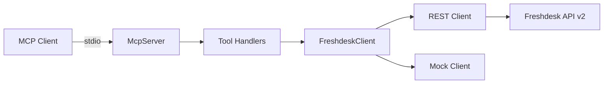

# Freshdesk MCP Connector

Private **read-only** [Model Context Protocol (MCP)](https://modelcontextprotocol.io) server that exposes Freshdesk support tickets to AI agents. Built for the Razorpay Forward-Deployed Engineer (Agent Studio) take-home assignment.

**Razorpay Agent Studio integration has not been independently verified.** This repository implements a standard MCP stdio server; connect any compatible MCP client using the configuration below.

## Assignment mapping

| Requirement | Implementation |
| --- | --- |
| API-key auth | Basic auth (`API_KEY:X`) via `FRESHDESK_API_KEY` |
| Freshdesk client | `src/freshdesk/client.ts` |
| list / get / search | MCP tools + client methods |
| Pagination & validation | Zod schemas, `MAX_PAGE_SIZE` |
| Rate limits & retries | `src/freshdesk/http.ts`, `src/resilience/*` |
| MCP tools | `src/tools/register-tools.ts` |
| Mock mode | `src/mock/*` (16 synthetic tickets) |
| Tests | `tests/unit`, `tests/integration`, `tests/evaluation` |
| Guardrails docs | `docs/security-and-guardrails.md`, `docs/agent-capabilities.md` |

## Architecture



See [docs/architecture.md](docs/architecture.md).

## Prerequisites

- Node.js **20+** (LTS recommended)
- npm 10+

## Installation

```bash
git clone <your-repo-url>
cd freshdesk-mcp-connector
npm install
cp .env.example .env
npm run build
```

## Mock mode (no credentials)

```bash
export FRESHDESK_MODE=mock
npm run demo
npm start
```

## Live Freshdesk setup

1. Log in to Freshdesk → profile → **Profile settings** → copy **API key**.
2. Note your helpdesk URL, e.g. `https://yourcompany.freshdesk.com`.
3. Configure environment:

```bash
export FRESHDESK_MODE=live
export FRESHDESK_BASE_URL=https://yourcompany.freshdesk.com
export FRESHDESK_API_KEY=your_api_key_here
npm run build && npm start
```

Never commit real API keys. Use `.env` locally (gitignored).

## Environment variables

| Variable | Default | Description |
| --- | --- | --- |
| `FRESHDESK_MODE` | `mock` | `mock` or `live` |
| `FRESHDESK_BASE_URL` | — | HTTPS Freshdesk base URL (live mode) |
| `FRESHDESK_API_KEY` | — | API key (live mode) |
| `LOG_LEVEL` | `info` | `debug` \| `info` \| `warn` \| `error` |
| `REQUEST_TIMEOUT_MS` | `10000` | HTTP timeout |
| `MAX_RETRIES` | `3` | Max retry attempts for transient errors |
| `MAX_PAGE_SIZE` | `100` | Upper bound for `page_size` |

## Run MCP server

```bash
npm run build
FRESHDESK_MODE=mock node dist/index.js
```

Logs go to **stderr**; stdout is reserved for MCP protocol messages.

### Sample MCP client configuration

Syntax depends on your MCP client (Cursor, Claude Desktop, etc.):

```json
{
  "mcpServers": {
    "freshdesk": {
      "command": "node",
      "args": ["/absolute/path/to/freshdesk-mcp-connector/dist/index.js"],
      "env": {
        "FRESHDESK_MODE": "mock",
        "LOG_LEVEL": "info"
      }
    }
  }
}
```

For live mode, add `FRESHDESK_BASE_URL` and `FRESHDESK_API_KEY` to `env`.

## MCP tools

### `list_tickets`

**Input:** `page`, `page_size`, optional `status`, `priority`  
**Output:** `tickets[]`, `pagination`, `has_more`

### `get_ticket`

**Input:** `ticket_id` (positive integer)  
**Output:** `ticket` object (sanitized fields)

### `search_tickets`

**Input:** `query`, `page`, `page_size`, optional `status`, `priority`  
**Output:** `tickets[]`, `pagination`, `has_more`, `total` (when available)

### Example tool output (truncated)

```json
{
  "tickets": [
    {
      "id": 1003,
      "subject": "Webhook delivery failures for settlement events",
      "status": 2,
      "priority": 4,
      "requesterId": 503,
      "createdAt": "2025-10-08T08:05:00Z",
      "updatedAt": "2025-10-09T16:45:00Z"
    }
  ],
  "pagination": { "page": 1, "page_size": 30 },
  "has_more": false
}
```

## Development scripts

| Script | Description |
| --- | --- |
| `npm run build` | Compile TypeScript |
| `npm run start` | Run compiled MCP server |
| `npm run dev` | Run server via `tsx` |
| `npm run demo` | Mock-mode CLI demonstration |
| `npm test` | Vitest unit + integration + evaluation |
| `npm run test:coverage` | Coverage report |
| `npm run lint` | ESLint |
| `npm run format:check` | Prettier check |

## Testing

```bash
npm test
```

Includes mocked HTTP tests for the live client and a stdio MCP integration test.

Evaluation details: [docs/evaluation.md](docs/evaluation.md).

## Security

See [docs/security-and-guardrails.md](docs/security-and-guardrails.md).

- HTTPS + host allowlist in live mode
- No secrets in logs or tool errors
- Read-only tools only
- Ticket content treated as untrusted

## Known limitations

[docs/limitations.md](docs/limitations.md)

## Troubleshooting

| Issue | Suggestion |
| --- | --- |
| MCP client shows no tools | Run `npm run build`; verify `dist/index.js` path |
| `CONFIG_ERROR` on start | Check `FRESHDESK_MODE`, URL, and API key |
| `AUTH_ERROR` in live mode | Regenerate API key; confirm agent permissions |
| `RATE_LIMITED` | Reduce call frequency; note per-plan Freshdesk limits |
| Empty search results | Try simpler keywords; confirm search API access on your plan |

## Freshdesk API references

- [Freshdesk API introduction](https://developers.freshdesk.com/api/)
- List tickets: `GET /api/v2/tickets`
- Get ticket: `GET /api/v2/tickets/:id`
- Search: `GET /api/v2/search/tickets?query=...`

## License

MIT — see [LICENSE](LICENSE).
