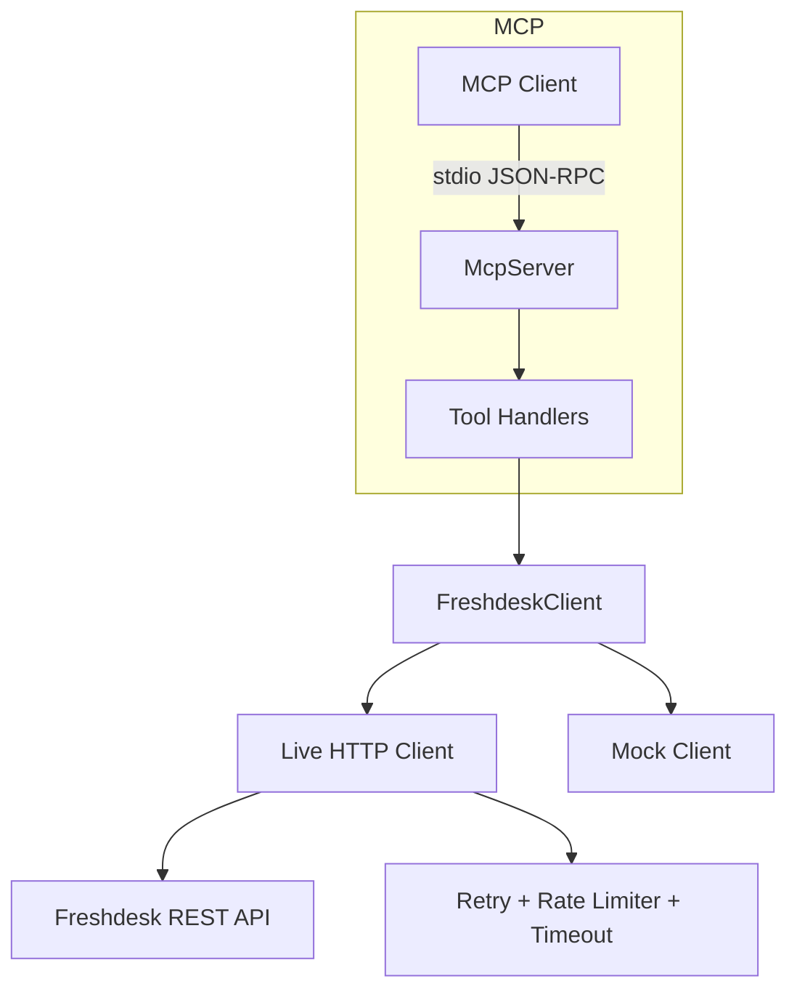

# Architecture

The connector is a read-only MCP server that exposes Freshdesk ticket operations as MCP tools. A single `FreshdeskClient` interface is implemented by either a live HTTP client or an in-memory mock client.

## Modules

| Module | Responsibility |
| --- | --- |
| `src/config.ts` | Environment validation, HTTPS + host allowlist |
| `src/freshdesk/client.ts` | Live REST integration |
| `src/mock/mock-client.ts` | Synthetic data, offline demo/tests |
| `src/resilience/*` | Retries, backoff, client-side throttling |
| `src/security/*` | Input validation helpers, log redaction |
| `src/tools/*` | MCP tool handlers and registration |

## Transport

Local development uses **stdio**. Protocol messages go to stdout; structured logs go to stderr.
